

# Muhammad Muqtasid

### Computer Science Student | Aspiring Full-Stack Developer

Building ideas into interactive, scalable, and meaningful digital experiences.

 

---

## About Me

I'm a Computer Science student and aspiring Full-Stack Developer interested in building modern web applications, exploring software architecture, and understanding how systems work behind the scenes.

- 🔭 Exploring full-stack development and building practical projects
- 🌱 Currently learning software engineering, system design, and advanced development concepts
- 👯 Interested in collaborating on web development and open-source projects
- 💬 Happy to discuss programming, web technologies, and project development
- ⚡ I enjoy transforming ideas into functional digital experiences

---

## 🛠️ Tech Stack & Tools

| Category | Technologies |
|---|---|
| **Languages** |       |
| **Frontend** |        |
| **Backend** |    |
| **Databases & Services** |     |
| **Development Tools** |     |
| **Deployment & Monitoring** |    |
| **Networking** |  |

---

## 📊 GitHub Activity Analytics

<a href="https://muqtasid-007.github.io/Muqtasid-007/"><b>▶ Open the interactive dashboard</b></a> &nbsp;·&nbsp; filters, custom dates and hover tooltips

<picture>
  <source media="(prefers-color-scheme: dark)" srcset="https://raw.githubusercontent.com/Muqtasid-007/Muqtasid-007/output/svg/heatmap-dark.svg">
  
</picture>

<b>Month</b> (last 30 days)

<picture>
  <source media="(prefers-color-scheme: dark)" srcset="https://raw.githubusercontent.com/Muqtasid-007/Muqtasid-007/output/svg/stats-month-dark.svg">
  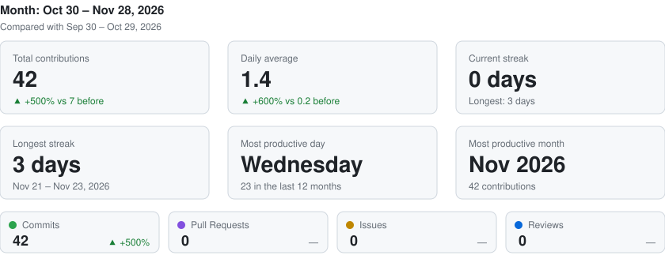
</picture>

<picture>
  <source media="(prefers-color-scheme: dark)" srcset="https://raw.githubusercontent.com/Muqtasid-007/Muqtasid-007/output/svg/trend-month-dark.svg">
  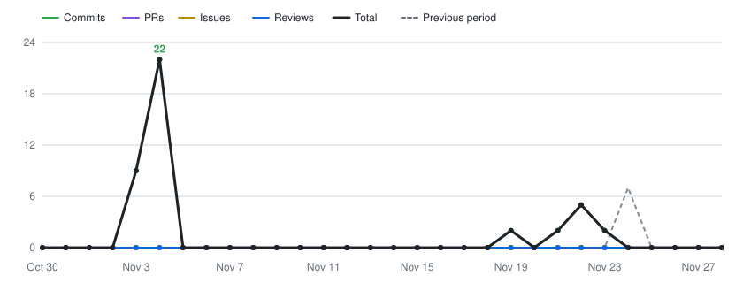
</picture>

<picture>
  <source media="(prefers-color-scheme: dark)" srcset="https://raw.githubusercontent.com/Muqtasid-007/Muqtasid-007/output/svg/repos-month-dark.svg">
  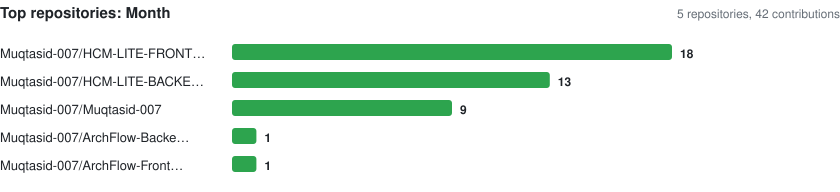
</picture>

<b>Day</b> (today vs yesterday)

<picture>
  <source media="(prefers-color-scheme: dark)" srcset="https://raw.githubusercontent.com/Muqtasid-007/Muqtasid-007/output/svg/stats-day-dark.svg">
  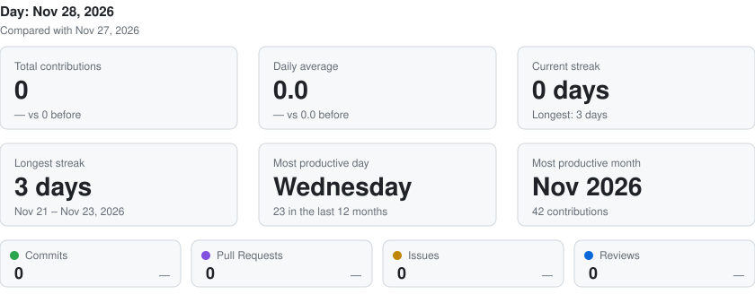
</picture>

<picture>
  <source media="(prefers-color-scheme: dark)" srcset="https://raw.githubusercontent.com/Muqtasid-007/Muqtasid-007/output/svg/trend-day-dark.svg">
  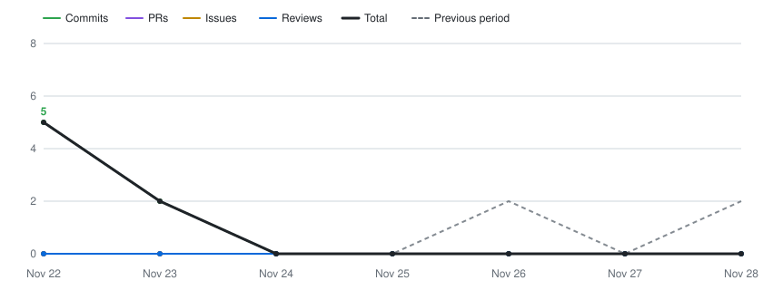
</picture>

<picture>
  <source media="(prefers-color-scheme: dark)" srcset="https://raw.githubusercontent.com/Muqtasid-007/Muqtasid-007/output/svg/repos-day-dark.svg">
  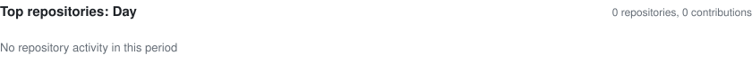
</picture>

<b>Week</b> (last 7 days)

<picture>
  <source media="(prefers-color-scheme: dark)" srcset="https://raw.githubusercontent.com/Muqtasid-007/Muqtasid-007/output/svg/stats-week-dark.svg">
  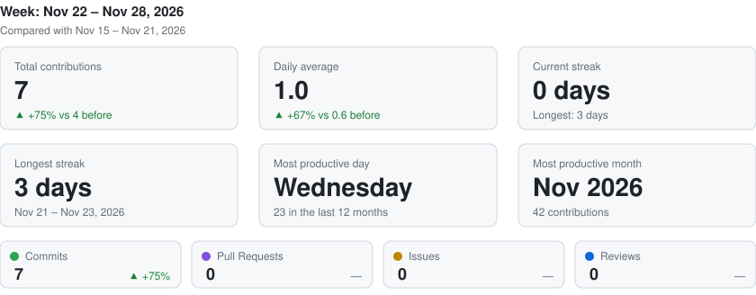
</picture>

<picture>
  <source media="(prefers-color-scheme: dark)" srcset="https://raw.githubusercontent.com/Muqtasid-007/Muqtasid-007/output/svg/trend-week-dark.svg">
  
</picture>

<picture>
  <source media="(prefers-color-scheme: dark)" srcset="https://raw.githubusercontent.com/Muqtasid-007/Muqtasid-007/output/svg/repos-week-dark.svg">
  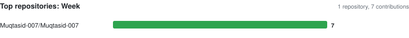
</picture>

<b>Year</b> (last 365 days)

<picture>
  <source media="(prefers-color-scheme: dark)" srcset="https://raw.githubusercontent.com/Muqtasid-007/Muqtasid-007/output/svg/stats-year-dark.svg">
  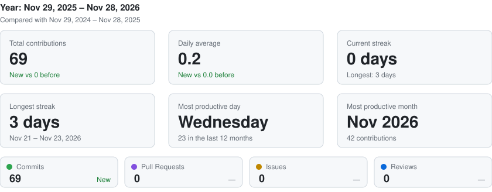
</picture>

<picture>
  <source media="(prefers-color-scheme: dark)" srcset="https://raw.githubusercontent.com/Muqtasid-007/Muqtasid-007/output/svg/trend-year-dark.svg">
  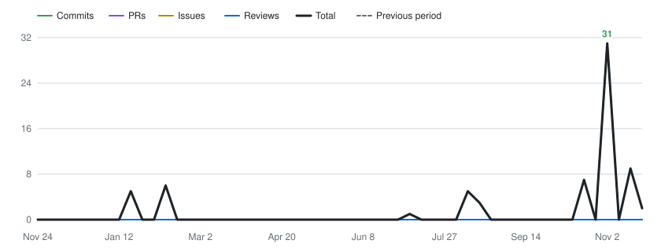
</picture>

<picture>
  <source media="(prefers-color-scheme: dark)" srcset="https://raw.githubusercontent.com/Muqtasid-007/Muqtasid-007/output/svg/repos-year-dark.svg">
  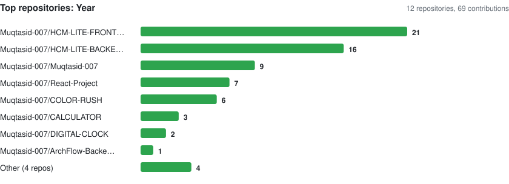
</picture>

<b>Custom range</b> (set in config.json or by running the workflow manually)

<picture>
  <source media="(prefers-color-scheme: dark)" srcset="https://raw.githubusercontent.com/Muqtasid-007/Muqtasid-007/output/svg/stats-custom-dark.svg">
  
</picture>

<picture>
  <source media="(prefers-color-scheme: dark)" srcset="https://raw.githubusercontent.com/Muqtasid-007/Muqtasid-007/output/svg/trend-custom-dark.svg">
  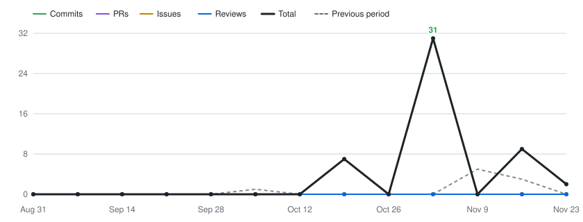
</picture>

<picture>
  <source media="(prefers-color-scheme: dark)" srcset="https://raw.githubusercontent.com/Muqtasid-007/Muqtasid-007/output/svg/repos-custom-dark.svg">
  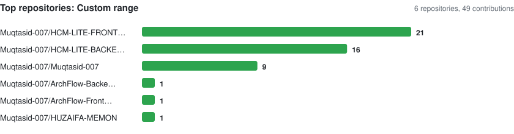
</picture>

Times are UTC. Totals count commits, PRs, issues and reviews only, so they can differ slightly from GitHub's own graph. Updated every 6 hours.

---

## Developer Quote

---

## Connect With Me

---

*Learning, building, experimenting, and evolving — one project at a time.*

